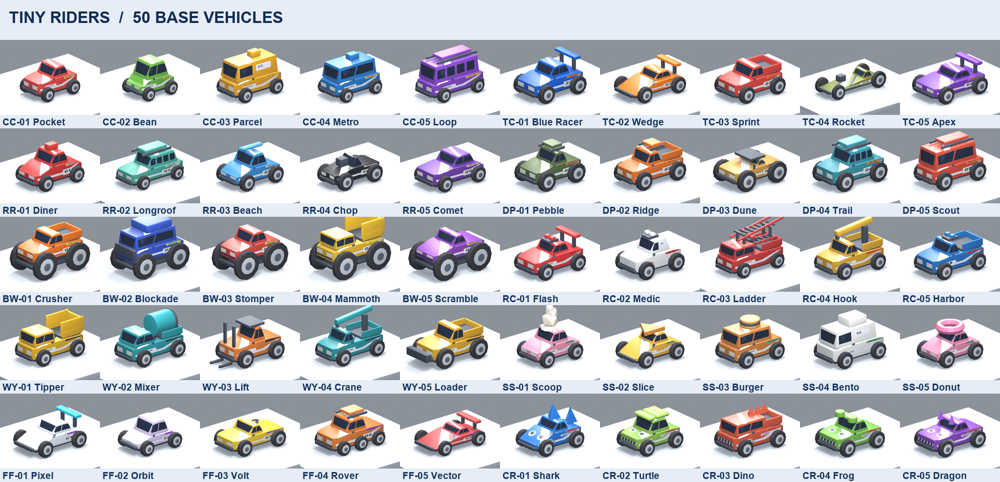
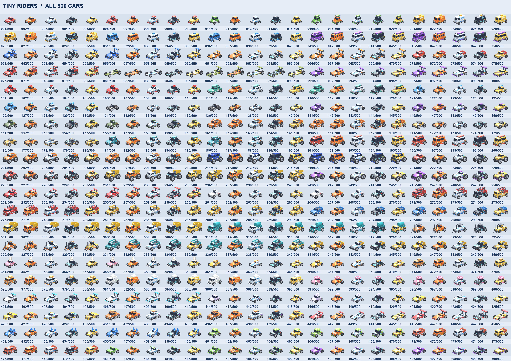
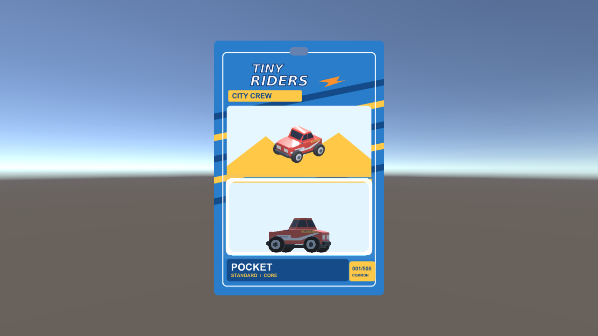
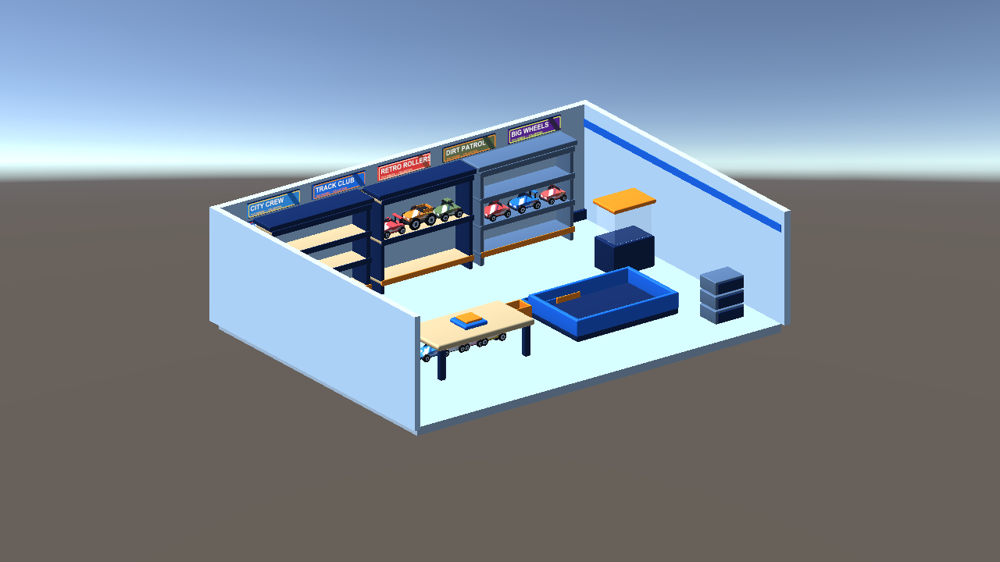

# Tiny Riders — final 3D art production report

Completed 13 October 2026. The source catalog contains 10 families, 50 named base designs, 100 standard/custom physical builds, and 500 stable collectible SKUs. All required car, packaging, and environment art was generated and imported into the Unity project.

## Delivered assets

| Deliverable | Verified count | Location |
| --- | ---: | --- |
| Base vehicle Blender files | 50 | `TinyRidersArt/blender/builds` |
| Standard/custom build Blender files and FBX exports | 100 each | `TinyRidersArt/blender/builds`, `TinyRidersArt/exports/builds` |
| Collectible car Blender files, FBX exports, and renders | 500 each | `TinyRidersArt/blender/products`, `TinyRidersArt/exports/products`, `TinyRidersArt/previews/products` |
| Unique 1024 px car prints with SVG source | 500 | `TinyRidersArt/textures/cars`, `TinyRidersArt/textures/source_artwork/cars` |
| Matching package Blender files, FBX exports, and renders | 500 each | `TinyRidersArt/blender/packages`, `TinyRidersArt/exports/packages`, `TinyRidersArt/previews/packages` |
| Unique 1200 × 1800 px package fronts and backs with SVG source | 500 pairs | `TinyRidersArt/textures/packages`, `TinyRidersArt/textures/source_artwork/packages` |
| Unity loose-car and packaged-product prefabs | 500 each | `Assets/TinyRidersArt/Prefabs` |
| Unity preview scenes | 7 | `Assets/TinyRidersArt/PreviewScenes` |
| Contact sheets and neutral clay renders | 33 and 11 | `TinyRidersArt/previews` |

The packaging uses one physical 120 × 180 mm master card with a hanger cutout and clear blister. Each front illustration comes from the corresponding rendered 3D collectible. Printed words, numbers, stripes, faces, logos, and card graphics are image textures; the clay audit removes them. Car variants share the appropriate physical build mesh while retaining their own SKU, print, material, source file, export, and prefab.

The sorting room includes a table, shelving, display cases, storage and counter forms, floor and wall finishes, ten printed family signs, and basic preview lighting. The Unity scenes include complete-collection, car, package, shelf, pile, stress, and sorting-room views. No gameplay logic was added.

## Validation

- File and image audit: 500 of 500 complete car products and 500 of 500 complete package products; zero missing product files.
- SHA-256 check: all 500 car prints, 500 package fronts, and 500 package backs have distinct image content.
- Blender geometry audit: 100 of 100 builds passed wheel, mesh, UV, and text-object checks; the packaging master passed its geometry and UV checks.
- Connected Unity Editor audit: 500 of 500 car prefabs have their correct SKU print; 500 of 500 package prefabs have their correct front and back prints, valid card UV0, and enclosed toy placement. All ten sign materials and seven scenes passed. Zero audit failures.
- Actual Unity captures confirm a textured loose car, a printed package front and back with the car inside, and the sorting room with readable signs.
- One base-silhouette metric pair remains above 0.92: SS-05 Donut versus CR-02 Turtle. Both actual renders were inspected. The former has a large doughnut roof; the latter has a turtle shell and face. The shared compact body causes the numerical flag, while the designs are visually distinct.

## Review images

## Production files

The deterministic Blender and artwork generators are in `TinyRidersArt/scripts`. The Unity importer and repeatable prefab audit are in `Assets/TinyRidersArt/Editor`. `PRODUCTION_STATE.json` records every SKU, generated path, per-file verification, current phase, and remaining work. `VALIDATION_REPORT.md`, `GEOMETRY_AUDIT.json`, and `UNITY_AUDIT.json` contain the detailed checks. `RESUME_HERE.md` contains exact revalidation commands if the collection is changed later.
