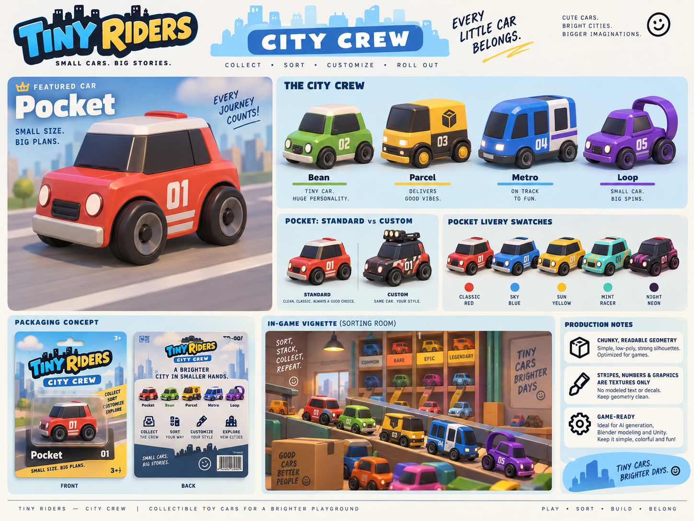
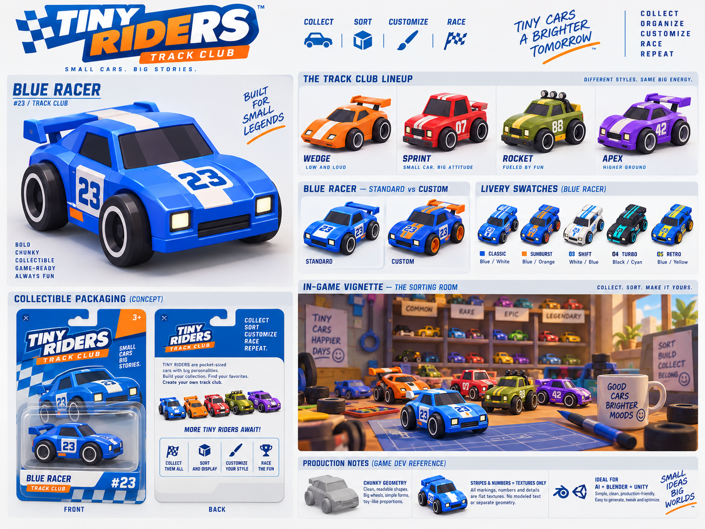
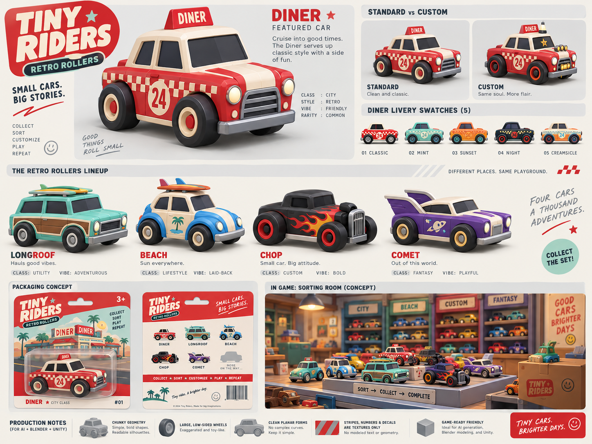
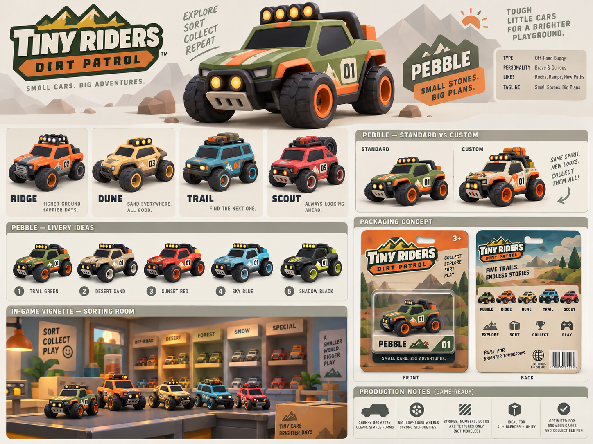
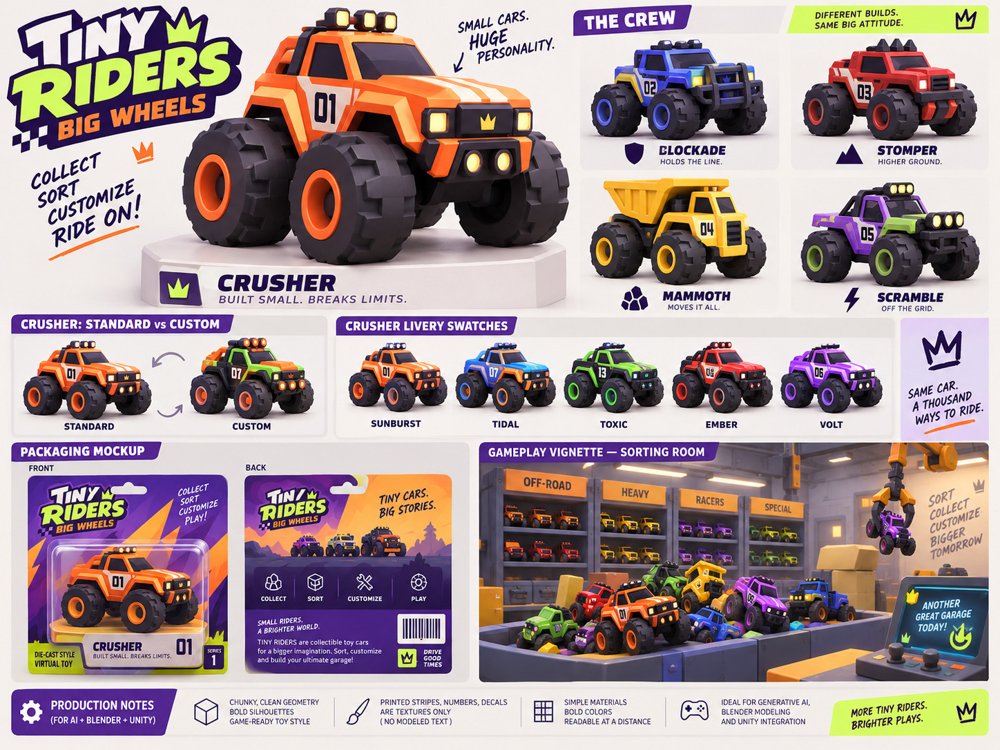
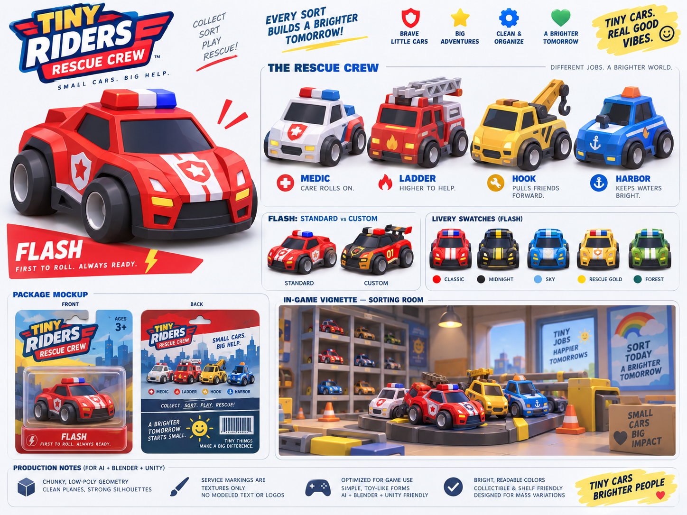
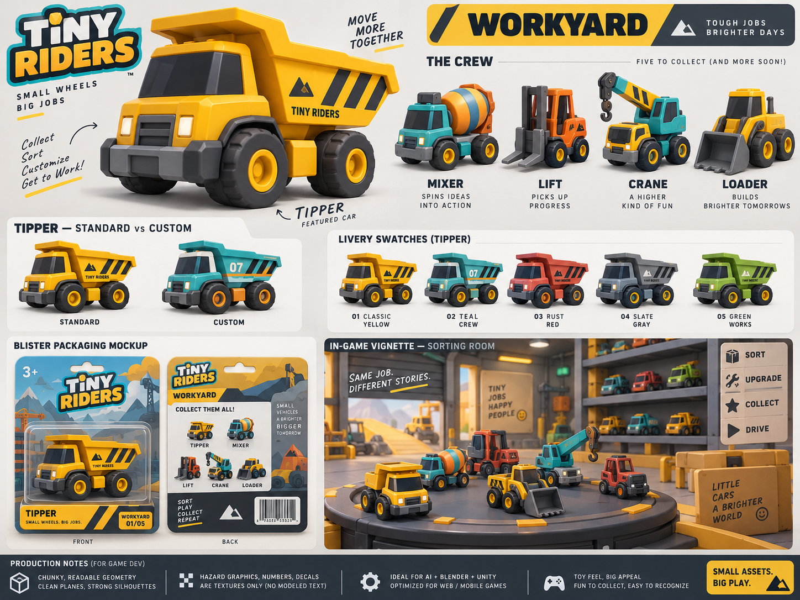
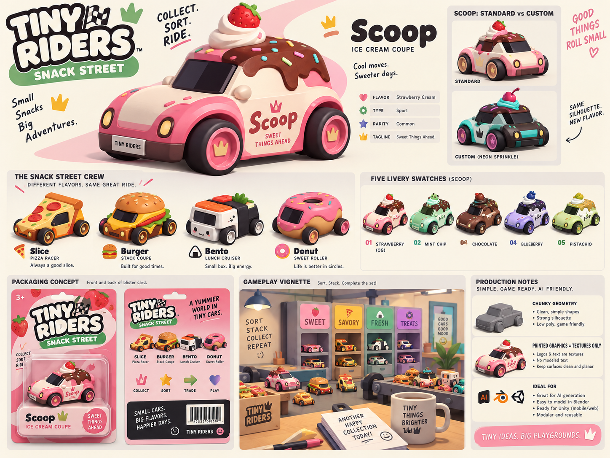
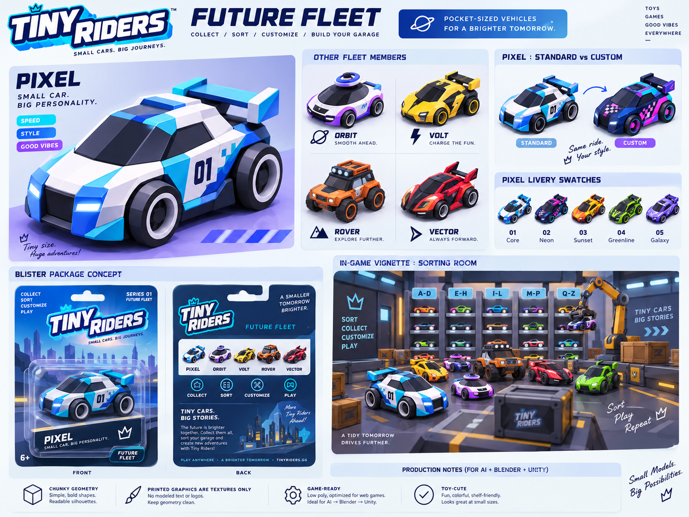
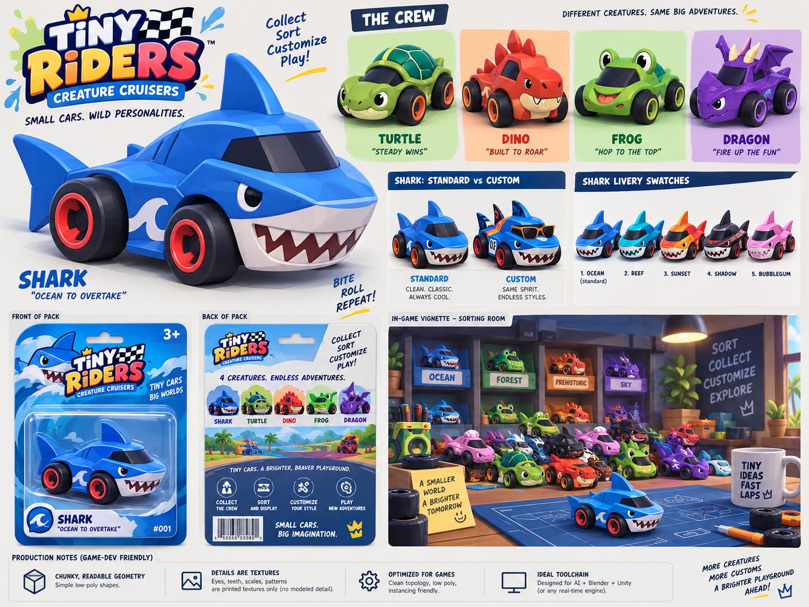

# Quick Visual Index of the 10 Original References

These original PNGs are included exactly as generated previously. Click relative links in a markdown viewer that supports local files. Each packaging crop is an art-direction crop, not UV print artwork.

## 01. City Crew

Package detail: [view crop](packaging_crops/01_city_crew.png)

## 02. Track Club

Package detail: [view crop](packaging_crops/02_track_club.png)

## 03. Retro Rollers

Package detail: [view crop](packaging_crops/03_retro_rollers.png)

## 04. Dirt Patrol

Package detail: [view crop](packaging_crops/04_dirt_patrol.png)

## 05. Big Wheels

Package detail: [view crop](packaging_crops/05_big_wheels.png)

## 06. Rescue Crew

Package detail: [view crop](packaging_crops/06_rescue_crew.png)

## 07. Workyard

Package detail: [view crop](packaging_crops/07_workyard.png)

## 08. Snack Street

Package detail: [view crop](packaging_crops/08_snack_street.png)

## 09. Future Fleet

Package detail: [view crop](packaging_crops/09_future_fleet.png)

## 10. Creature Cruisers

Package detail: [view crop](packaging_crops/10_creature_cruisers.png)
